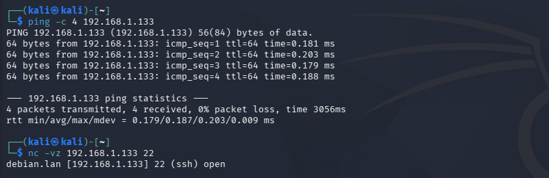
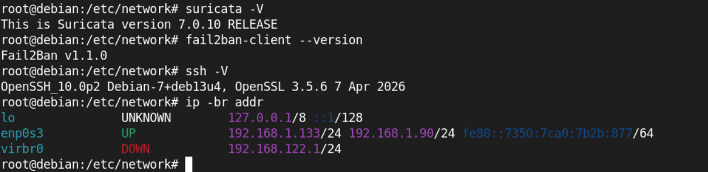
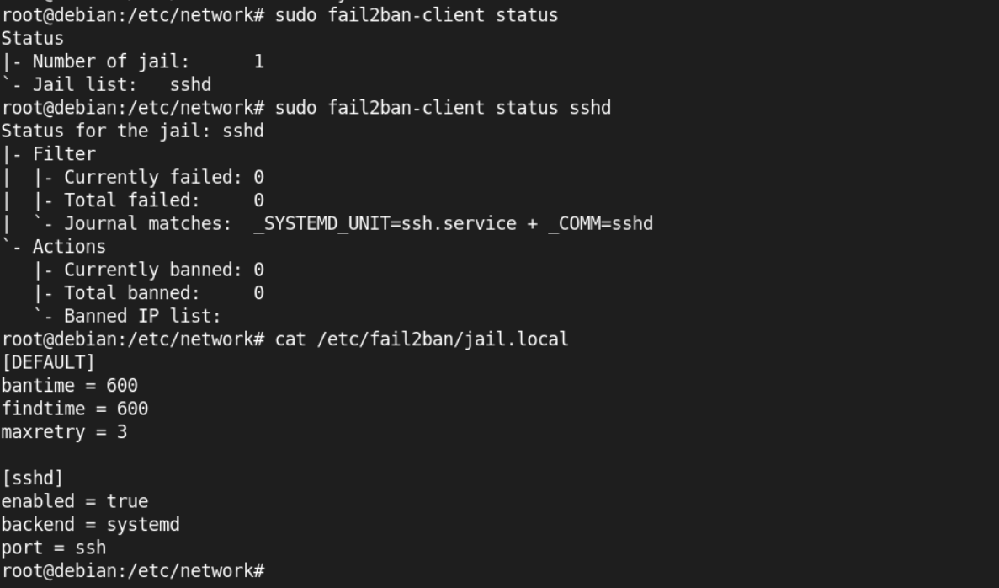
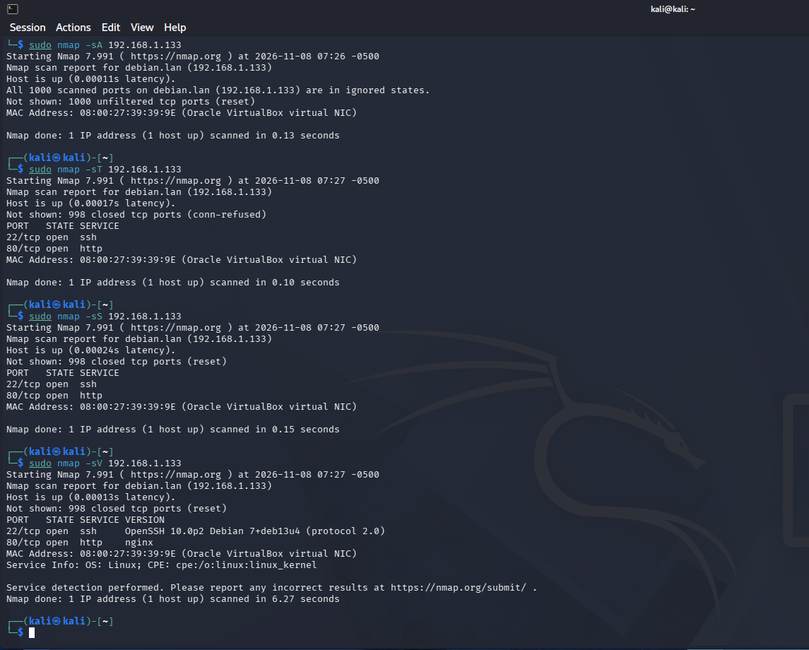
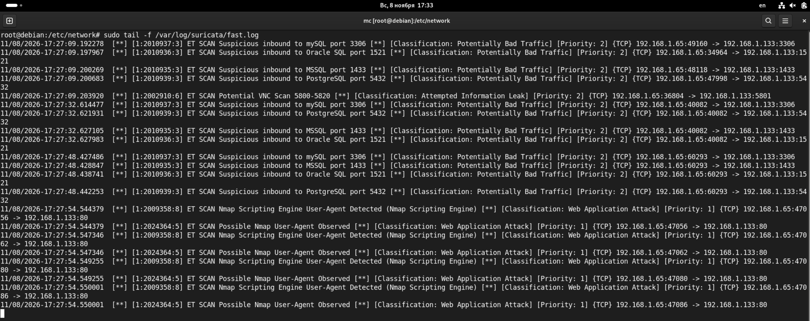
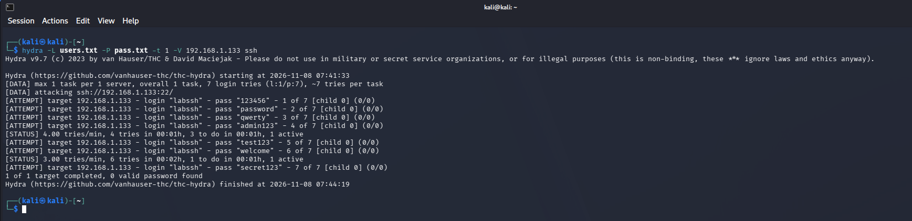
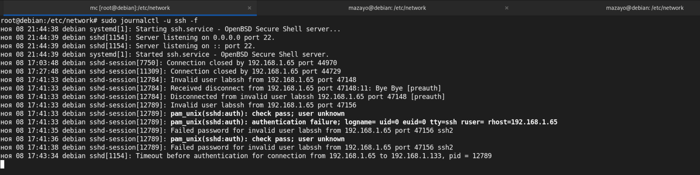
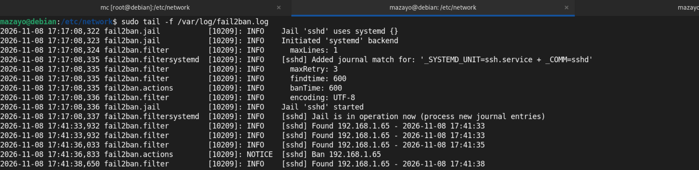
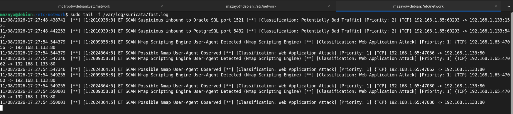

# Домашнее задание к занятию "`Защита сети`" - `Насибуллин Михаил`

---
### Подготовка
Имеется 2 виртуальные машины:<br>
 - Debian 13 с ip адресами 192.168.1.133 и 192.168.1.90<br>
 - Kali linux с ip адресом 192.168.1.65<br>
На Debian 13 установлены Suricata и Fail2Ban<br>





---
### Задание 1

Проведите разведку системы и определите, какие сетевые службы запущены на защищаемой системе:<br>
```
sudo nmap -sA < ip-адрес >
```
```
sudo nmap -sT < ip-адрес >
```
```
sudo nmap -sS < ip-адрес >
```
```
sudo nmap -sV < ip-адрес >
```
По желанию можете поэкспериментировать с опциями: https://nmap.org/man/ru/man-briefoptions.html.<br>
В качестве ответа пришлите события, которые попали в логи Suricata и Fail2Ban, прокомментируйте результат.<br>

### Ответ




В ходе выполнения задания было проведено сканирование защищаемого сервера Debian 13 (192.168.1.133) с машины Kali Linux (192.168.1.65) с использованием Nmap.<br>
При ACK-сканировании (`-sA`) все 1000 проверенных портов получили состояние `unfiltered`, поскольку сервер отвечал пакетами RST. При этом в журнале Suricata предупреждений не появилось, так как сетевой трафик не вызвал срабатывания загруженных сигнатур.<br>
При TCP Connect (`-sT`) и SYN-сканировании (`-sS`) были обнаружены два открытых порта: 22 (SSH) и 80 (HTTP). В журнале Suricata появились предупреждения о подозрительных обращениях к портам баз данных MySQL, PostgreSQL, MSSQL и Oracle.<br>
При сканировании с определением версий (`-sV`) были идентифицированы OpenSSH 10.0p2 и веб-сервер nginx. Кроме того, Suricata зафиксировала HTTP-запросы с User-Agent, характерным для Nmap, что подтверждается событиями `ET SCAN Nmap Scripting Engine User-Agent Detected`.<br>
Таким образом, Suricata успешно обнаружила ряд признаков сетевой разведки с использованием стандартных правил Emerging Threats.<br>

---

### Задание 2

Проведите атаку на подбор пароля для службы SSH:<br>

```
hydra -L users.txt -P pass.txt < ip-адрес > ssh
```

1. Настройка hydra:<br>
 - создайте два файла: users.txt и pass.txt;<br>
 - в каждой строчке первого файла должны быть имена пользователей, второго — пароли. В нашем случае это могут быть случайные строки, но ради эксперимента можете добавить имя и пароль существующего пользователя.<br>
Дополнительная информация по hydra: https://kali.tools/?p=1847.<br>

2. Включение защиты SSH для Fail2Ban:<br>
 - открыть файл /etc/fail2ban/jail.conf,<br>
 - найти секцию ssh,<br>
 - установить enabled в true.<br>
Дополнительная информация по Fail2Ban:https://putty.org.ru/articles/fail2ban-ssh.html.<br>

В качестве ответа пришлите события, которые попали в логи Suricata и Fail2Ban, прокомментируйте результат.<br>

### Ответ

На защищаемом сервере была настроена защита SSH с помощью Fail2Ban. Установлены следующие параметры: maxretry = 3, findtime = 600, bantime = 600. Таким образом, после трёх зарегистрированных неудачных попыток авторизации в течение 10 минут IP-адрес источника блокируется на 600 секунд.<br>

На Kali Linux были подготовлены два файла: users.txt со списком пользователей (добавил только одного  пользователя) и pass.txt со списком паролей.<br>

Для запуска подбора паролей использовалась команда:<br>

```
hydra -L users.txt -P pass.txt -t 1 -V 192.168.1.133 ssh
```



В результате Hydra выполнила тест с семью комбинациями учётных данных. Подходящий пароль найден не был, о чём свидетельствует сообщение 0 valid password found.<br>

### Cобытия в журнале SSH на Debian.



В журнале SSH были зафиксированы попытки авторизации пользователя labssh с IP-адреса 192.168.1.65. Сервер определил пользователя как несуществующего (Invalid user), а также зарегистрировал ошибки авторизации (Failed password).<br>

### Обнаружение попыток входа и блокировка IP-адреса средствами Fail2Ban.



В журнале /var/log/fail2ban.log появились сообщения Found 192.168.1.65. После регистрации трёх событий Fail2Ban выполнил блокировку IP-адреса злоумышленника, что подтверждается записью:<br>

2026-11-08 17:41:36,833 fail2ban.actions [10209]: NOTICE  [sshd] Ban 192.168.1.65<br>

Таким образом, защита от перебора паролей успешно сработала.<br>

### журнал Suricata.



При выполнении атаки Hydra новых предупреждений в журнале /var/log/suricata/fast.log не появилось. Это объясняется тем, что SSH использует шифрование, а Suricata формирует предупреждения только при совпадении сетевого трафика с установленными правилами обнаружения.<br>
В отличие от Suricata, Fail2Ban анализирует сообщения SSH о неудачной авторизации, благодаря чему может обнаруживать попытки подбора паролей и блокировать источник.<br>

Вывод: в ходе эксперимента была продемонстрирована работа защиты SSH от перебора паролей. Fail2Ban успешно обнаружил подозрительную активность с IP-адреса 192.168.1.65 и заблокировал его. Suricata не сформировала отдельных предупреждений об этой атаке. Эксперимент показал, что Fail2Ban и Suricata выполняют разные задачи и могут дополнять друг друга при защите сервера.

